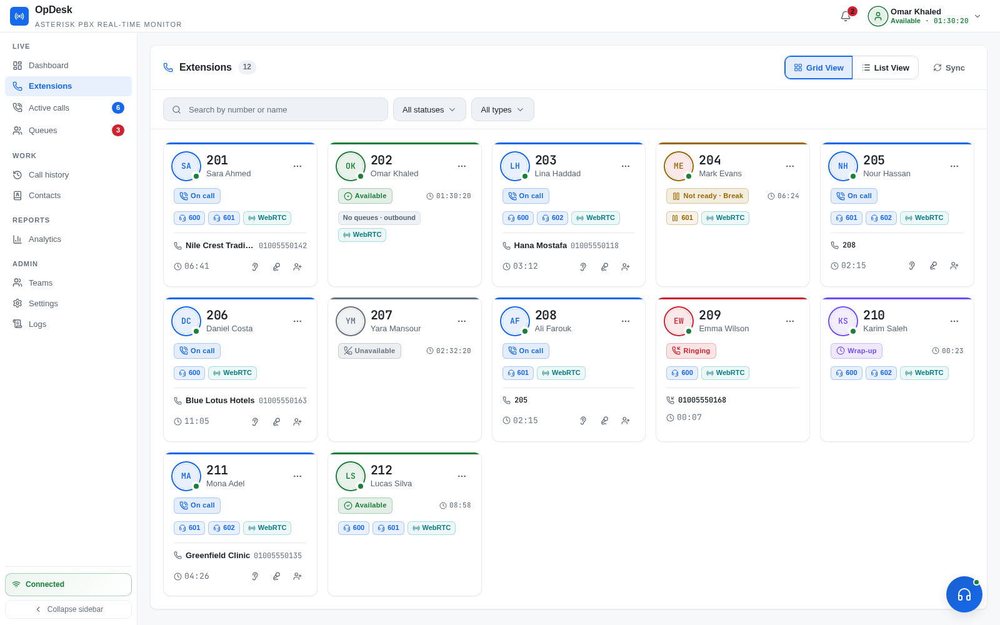
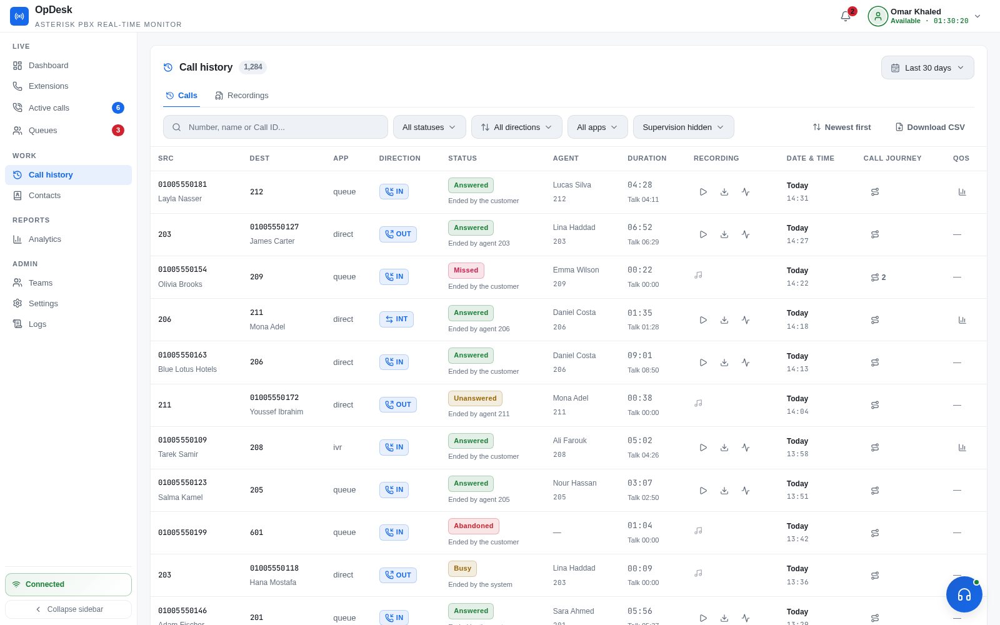
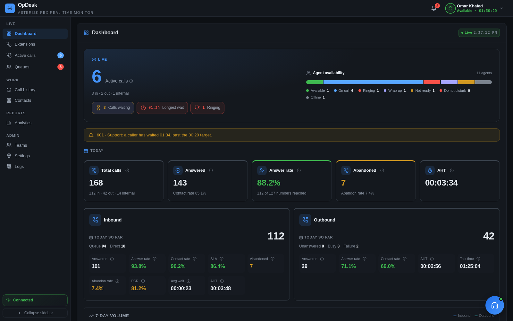
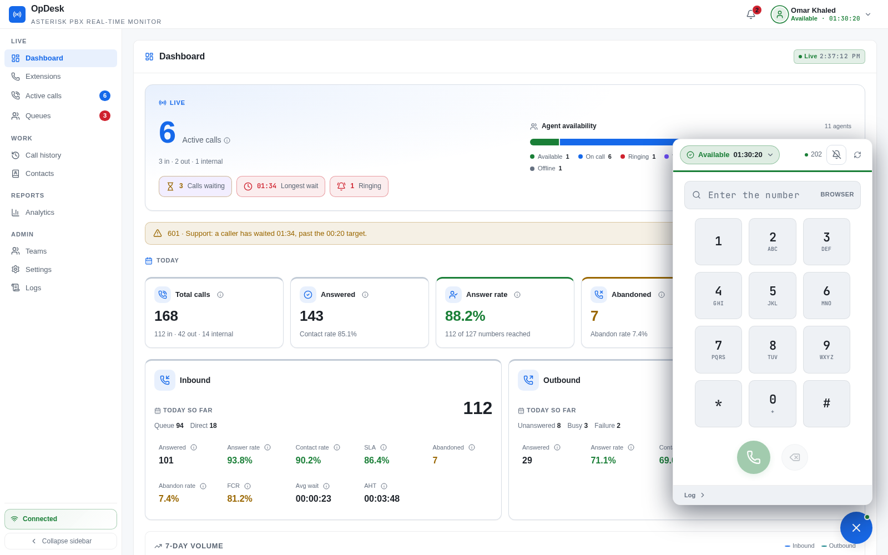
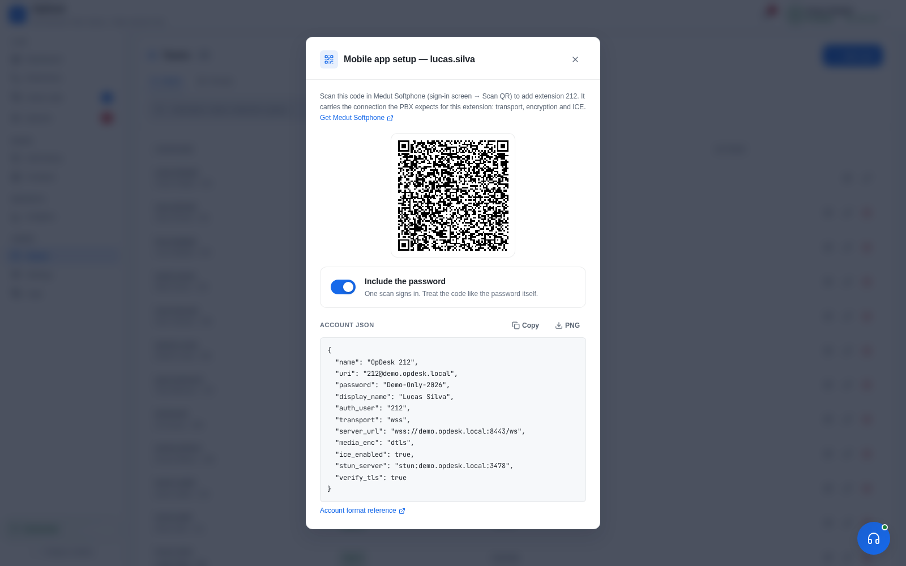
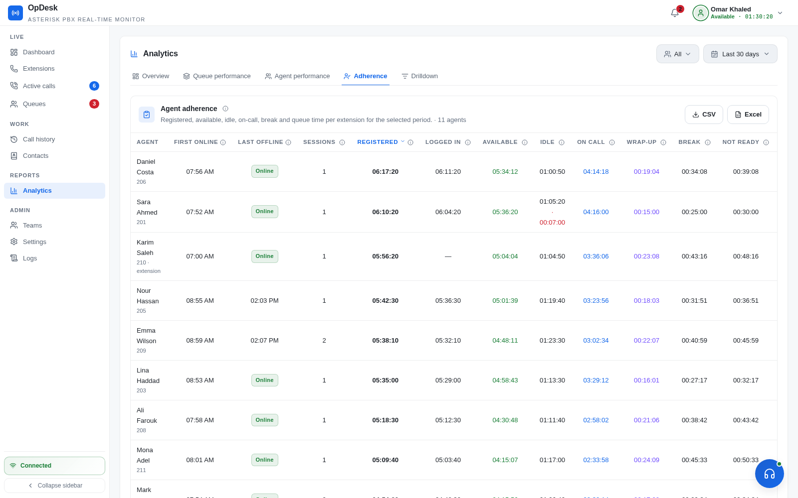
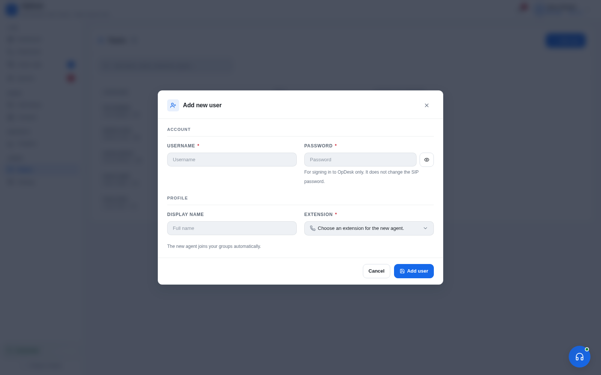

<div dir="rtl">

# Voiz Console

<a href="./screenshots/cc-fa-stats1.png">
  
</a>

### پنل حرفه‌ای مدیریت، پایش و تحلیل مرکز تماس مبتنی بر Asterisk

[](https://github.com/voipiran/voiz-contact-center)
[](https://github.com/voipiran/voiz-contact-center)
[](https://nestjs.com/)
[](https://react.dev/)
[](https://www.asterisk.org/)
[](LICENSE)

**Voiz Contact Center** یک راهکار بومی و یکپارچه برای مدیریت مرکز تماس است که روی Asterisk اجرا می‌شود و اطلاعات تماس، داخلی‌ها، صف‌ها و عملکرد کارشناسان را در یک پنل وب مدرن در اختیار مدیران و کاربران قرار می‌دهد.

این پروژه بر پایه پروژه والد **[OpDesk](https://github.com/Ibrahimgamal99/OpDesk)** توسعه داده شده و برای محیط‌های فارسی‌زبان، چیدمان راست‌به‌چپ (RTL)، نیازهای عملیاتی مجموعه‌های ایرانی و کار با **Issabel / FreePBX** بهینه‌سازی شده است. کد و اسکریپت‌های این مخزن بسته‌بندی اختصاصی Voiz هستند؛ برای نصب، از دستورهای همین صفحه استفاده کنید.

</div>

---

**Live operations**
- **Real-time panel**: extension status, active calls, queues and call notifications pushed over a WebSocket, with no polling.
- **Dashboard**: active, waiting and ringing calls, longest wait, agent availability and today's KPIs.
- **Supervision**: listen, whisper and barge, allowed per user.
- **Three roles**: **Admin** (everything), **Supervisor** (their assigned agents and queues; can add agents, who join their groups automatically), **Agent** (their own call history; live view of their groups).
- **Extensions page**: every extension as a card (or a row in List view) with its status, time in state, how much of its break window is used (amber from 80%, red past it), its queues and its live call. Supervisors and admins get a ⋯ menu on each card: set a break or Available, log in or out of queues, turn DND on or off, listen / whisper / barge, the agent's timeline and calls today, or call the extension. The agent sees a message saying who changed their status, and the change is in the audit log.
- **Presence**: availability follows the phone. Queue login is separate and ends only on a logout or DND. A call during a break or wrap-up counts as On Call, and a daily shift reset restarts the timers and signs off idle agents.
- **Not-Ready codes**: agents pause with a reason. The reason is kept across device changes, wrap-up time is applied after calls, and adherence is reported per agent with a timeline.

**Calling**
- **Web softphone**: make and take calls in the browser over WebRTC, with hold, mute, transfer, queue login/logout, DND, and Available / Break with a reason code. The same status controls are in the header profile menu, and the avatar there wears your status colour.
- **Mobile softphone**: sign a phone in by scanning a QR code, and wake a closed app for incoming calls with **RFC 8599** push (FCM / APNs VoIP), one push per phone, showing the caller's name. Recommended app: [Medut Softphone](https://github.com/Ibrahimgamal99/medut-softphone). → [guide](docs/guides/mobile-push.md)
- **Recording**: full-call and per-leg recordings, with recording policy per direction and extension, retention, storage stats, and automatic talk/silence analysis (Silero VAD).

## فهرست مطالب

- [معرفی کوتاه](#معرفی-کوتاه)
- [نصب سریع](#نصب-سریع)
- [تصاویر محیط برنامه](#تصاویر-محیط-برنامه)
- [قابلیت‌ها](#قابلیت‌ها)
- [پیش‌نیازها](#پیشنیازها)
- [راه‌اندازی اتصال مرکز تماس](#راهاندازی-اتصال-مرکز-تماس)
- [معماری و فناوری‌ها](#معماری-و-فناوریها)
- [ساختار پروژه](#ساختار-پروژه)
- [مستندات و پشتیبانی](#مستندات-و-پشتیبانی)
- [پروژه والد و مجوز](#پروژه-والد-و-مجوز)

## معرفی کوتاه

Voiz Contact Center برای تیم‌هایی طراحی شده است که می‌خواهند بدون جایگزین‌کردن Asterisk، یک لایه مدیریتی و عملیاتی کامل روی سیستم تلفنی خود داشته باشند. سامانه رویدادهای Asterisk را از طریق AMI دریافت می‌کند، وضعیت زنده را از طریق WebSocket به مرورگر می‌رساند و داده‌های تماس و گزارش‌ها را از طریق API در اختیار رابط کاربری قرار می‌دهد.

این راهکار برای استفاده در مرکز تماس، واحد فروش، پشتیبانی، نظرسنجی و تیم‌های خدمات مشتری مناسب است و می‌تواند در کنار تنظیمات فعلی Issabel یا FreePBX نصب شود.

## نصب سریع

### نصب کامل روی Issabel

دستور زیر را روی سرور PBX اجرا کنید:

```bash
cd /opt && \
rm -rf voiz-console voiz-console.tar.gz && \
curl -fL https://voipiran.io/clover/voiz-console.tar.gz \
  -o voiz-console.tar.gz && \
mkdir -p voiz-console && \
tar -xzf voiz-console.tar.gz --strip-components=1 -C voiz-console && \
cd voiz-console && \
sudo bash install-console.sh
```

`install-console.sh` نقطه‌ی شروع واحد نصب است. روی Issabel 5، همین فایل Console، وابستگی‌های آفلاین، تنظیمات Nginx، ChanSpy و سفارشی‌سازی‌های VOIPIRAN را انجام می‌دهد؛ فایل جداگانه‌ی `contactcenter.sh` دیگر وجود ندارد.

آرشیو نصب باید در مسیر `https://voipiran.io/clover/voiz-console.tar.gz` منتشر شده باشد. این بسته می‌تواند وابستگی‌های آماده‌شده را در `offline-assets/el8-x86_64` همراه خود داشته باشد؛ نصب‌کننده ابتدا از فایل‌های محلی استفاده می‌کند و در نبود آن‌ها از مسیرهای آفلاین ویپ ایران کمک می‌گیرد.

### آماده‌سازی وابستگی‌های آفلاین

برای ساخت مجدد بسته‌ها، اسکریپت زیر را روی یک میزبان متصل به مخازن و سازگار با EL8 x86_64 اجرا کنید؛ این اسکریپت برای اجرا روی PBX مقصد نیست:

```bash
bash scripts/prepare-offline-assets.sh /tmp/voiz-console-assets
```

خروجی در `/tmp/voiz-console-assets/el8-x86_64` ساخته می‌شود و شامل RPMهای وابستگی، wheelهای Python، کش npm، NVM و Node.js است. فایل‌های این پوشه و آرشیو Console باید پس از بررسی در مسیرهای متناظر زیر `/clover` روی سایت ویپ ایران منتشر شوند. این مجموعه فعلاً برای EL8 x86_64 آماده شده است؛ بسته‌های Issabel 4 / EL7 در آن نیستند.

اگر میزبان EL8 برای آماده‌سازی در دسترس نیست، مخزن را به GitHub ببرید و از مسیر **Actions → Prepare EL8 offline bundle → Run workflow** اجرا کنید. Workflow وابستگی‌های RPM را داخل Rocky Linux 8 resolve می‌کند، نصب مجموعهٔ RPM را با Repositoryهای غیرفعال می‌آزماید و آرشیو `voiz-console.tar.gz` به‌همراه checksum را به‌عنوان Artifact می‌سازد. Artifact را دانلود کنید و فقط پس از موفقیت Workflow برای نصب یا انتشار استفاده کنید.

محتوای پوشه‌های `contactcenter-rpms`، `contactcenter-wheels`، `contactcenter-vad-wheels`، `contactcenter-runtime` و `nginx-rpms` را به‌ترتیب در مسیرهای هم‌نام زیر `/clover` منتشر کنید؛ آرشیو Console نیز باید در `/clover/voiz-console.tar.gz` باشد. فایل‌های `manifest.txt` و `SHA256SUMS` هر مجموعه را همراه همان مجموعه نگه دارید.

برای ساخت آرشیو Console از ریشه مخزن:

```bash
tar -czf /tmp/voiz-console.tar.gz \
  --exclude='*/.git' --exclude='*/node_modules' --exclude='*/backend/dist' \
  --exclude='*/contactcenter.sh.bak' \
  -C .. "$(basename "$PWD")"
sha256sum /tmp/voiz-console.tar.gz > /tmp/voiz-console.tar.gz.sha256
```

آرشیو و فایل `.sha256` را با هم در مسیر `/clover` منتشر کنید.

### نصب کنسول روی Issabel یا اجرای نصب‌کننده به‌تنهایی

```bash
sudo rm -rf /opt/voiz-console
sudo mkdir -p /opt/voiz-console
sudo curl -fL https://voipiran.io/clover/voiz-console.tar.gz \
  -o /tmp/voiz-console.tar.gz
sudo tar -xzf /tmp/voiz-console.tar.gz --strip-components=1 \
  -C /opt/voiz-console
cd /opt/voiz-console
sudo bash install-console.sh
```

اسکریپت `install-console.sh` محیط لازم را آماده می‌کند، نسخه‌ی bundled برنامه را در `/opt/OpDesk` قرار می‌دهد، Node.js و Python مورد نیاز را بررسی/نصب می‌کند و سرویس‌های لازم را آماده می‌سازد. روی Issabel 5 همچنین تنظیمات PBX و سفارشی‌سازی‌های VOIPIRAN را اعمال می‌کند. نصب‌کننده کد را از پروژه‌ی والد Clone نمی‌کند؛ از نسخه‌ی هماهنگ‌شده‌ی همین مخزن استفاده می‌شود.

نصب‌کننده ابتدا وجود Node.js 20+ به‌همراه npm را بررسی می‌کند و فقط در صورت نیاز NVM را از آرشیو محلی/آینه ویپ ایران آماده می‌کند. در بسته آفلاین، Node.js، کش npm و wheelهای VAD از فایل‌های محلی/آینه ویپ ایران نصب می‌شوند؛ برای دریافت NVM یا Node.js به GitHub مراجعه نمی‌شود و NVM فقط runtime محلی را فعال می‌کند.

فایل `install.sh` نسخه‌ی اصلی OpDesk از شاخه‌ی upstream است و فقط برای مقایسه و بررسی تغییرات نگه‌داری می‌شود؛ برای نصب Voiz آن را اجرا نکنید. تغییرات مهم upstream باید پس از بررسی، به‌صورت انتخابی به `install-console.sh` منتقل شوند تا تنظیمات اختصاصی Voiz حفظ شوند.

در ابتدای نصب، اگر `curl` و `openssl` از قبل روی سیستم موجود باشند، هیچ بسته‌ای برای ابزارهای پایه نصب نمی‌شود. نصب Python، Nginx و وابستگی‌های runtime در مراحل بعدی و فقط در صورت نیاز انجام می‌شود؛ در آن مراحل مدیر بسته سیستم‌عامل ممکن است متادیتای Repositoryهای فعال را بررسی کند.

### اجرای مستقیم نسخه‌ی موجود در مخزن

اگر پروژه از قبل روی سرور قرار دارد، نصب را با همین نقطه‌ی ورود اجرا کنید:

```bash
cd /opt/voiz-console
sudo bash install-console.sh
```

روی سیستم‌های غیر Issabel، نصب‌کننده فقط اجزای Console را آماده می‌کند و تنظیمات اختصاصی Issabel را رد می‌کند.

> اجرای نصب با `sudo` توصیه می‌شود، چون اسکریپت با مسیرهای سیستمی، تنظیمات Asterisk و سرویس‌های سیستم‌عامل کار می‌کند.

## تصاویر محیط برنامه

برای مشاهده‌ی بزرگ هر تصویر، روی آن کلیک کنید.

<table>
  <tr>
    <td><a href="./screenshots/cc-fa-dashboard1.png"></a></td>
    <td><a href="./screenshots/cc-fa-queue1.png"></a></td>
    <td><a href="./screenshots/cc-fa-stats1.png"></a></td>
    <td><a href="./screenshots/cc-fa-webphone1.png"></a></td>
    <td><a href="./screenshots/extensions.png"></a></td>
    <td><a href="./screenshots/call_log.png"></a></td>
  </tr>
  <tr>
    <td><a href="./screenshots/dashboard_dark.png"></a></td>
    <td><a href="./screenshots/cc-fa-queue1-dark.png"></a></td>
    <td><a href="./screenshots/cc-fa-stats1-dark.png"></a></td>
    <td><a href="./screenshots/cc-fa-webphone1-white.png"></a></td>
    <td><a href="./screenshots/softphone.png"></a></td>
    <td><a href="./screenshots/mobile_qr.png"></a></td>
  </tr>
</table>

| Agent adherence | Supervisor adds an agent |
|---|---|
| [](screenshots/adherence.png) | [](screenshots/supervisor_teams.png) |

## قابلیت‌ها

### مدیریت و پایش لحظه‌ای

- داشبورد زنده برای وضعیت داخلی‌ها، تماس‌های فعال، صف‌ها و کارشناسان
- نمایش تماس‌های در حال زنگ‌خوردن، پاسخ‌داده‌شده و در انتظار
- مشاهده طولانی‌ترین زمان انتظار و شاخص‌های کلیدی روزانه
- به‌روزرسانی رویدادها با WebSocket و بدون وابستگی به polling مداوم
- پشتیبانی از نقش‌های مدیریتی و سطح دسترسی کاربران

### کنترل تماس و نظارت کارشناسان

- برقراری و دریافت تماس از داخل مرورگر با WebRTC و SIP.js
- نگه‌داشتن تماس، بی‌صداکردن، انتقال و کنترل وضعیت آماده / غیرآماده
- ورود و خروج کارشناس از صف
- شنود تماس، Whisper و Barge با سطح دسترسی کنترل‌شده
- پشتیبانی از Softphone موبایل و تولید QR برای ورود سریع
- ضبط مکالمات و تحلیل سکوت / گفت‌وگو با VAD

### گزارش‌گیری و تحلیل

- تاریخچه کامل تماس‌ها و جست‌وجوی چندمعیاره
- نمایش مسیر تماس (Call Journey) برای تماس‌های چندمرحله‌ای
- گزارش عملکرد صف‌ها و کارشناسان
- شاخص‌های KPI، تغییرات دوره‌ای و نمودارهای تحلیلی
- خروجی CSV و XLSX
- تحلیل کیفیت تماس و دسترسی به فایل ضبط‌شده

### ارتباط با CRM و API

- دفترچه تلفن متمرکز و نمایش نام مخاطب در پنل
- ارسال اطلاعات تماس به CRM از طریق Webhook
- ثبت لاگ ارسال‌ها و امکان ارسال مجدد
- REST API با کلیدهای دسترسی و Scope
- Click-to-Call و دریافت اطلاعات مخاطب از CRM
- لاگ رویدادهای AMI، Trace مربوط به SIP و رخدادهای CRM

### رابط کاربری فارسی

- بهینه‌شده برای زبان فارسی و چیدمان RTL
- طراحی واکنش‌گرا برای دسکتاپ، تبلت و موبایل
- پشتیبانی از حالت روشن و تاریک
- تمرکز بر خوانایی، دسترسی سریع و استفاده عملیاتی در محیط مرکز تماس

## پیش‌نیازها

| مورد | توضیح |
|---|---|
| سیستم تلفنی | Issabel یا FreePBX مبتنی بر Asterisk |
| دسترسی Asterisk | فعال‌بودن AMI روی پورت `5038` و HTTP/WebSocket روی پورت `8088` |
| سیستم‌عامل | Debian 12+، Ubuntu یا توزیع‌های خانواده RHEL |
| دسترسی نصب | دسترسی `root` یا کاربری دارای `sudo` |
| پایگاه داده | MySQL یا MariaDB و دسترسی به دیتابیس‌های Asterisk و CDR |
| ابزارهای پایه | `curl` و `openssl`؛ اسکریپت نصب فقط ابزارهای ضروریِ مفقود را نصب می‌کند |
| نصب عمومی | برای HTTPS عمومی، دامنه‌ای که به سرور اشاره کند و دسترسی پورت ۸۰ برای Let's Encrypt |

> **نکته پورت‌ها:** در Issabel و FreePBX معمولاً Apache پورت‌های ۸۰ و ۴۴۳ را در اختیار دارد. اسکریپت نصب در صورت نیاز پورت جایگزین HTTPS (پیش‌فرض `8443`) را پیشنهاد می‌کند. پیش از نصب، وضعیت سرویس‌های فعال و فایروال را بررسی کنید.

## راه‌اندازی اتصال مرکز تماس

`install-console.sh` روی Issabel 5 نصب کامل را انجام می‌دهد و تنظیمات ChanSpy و Feature Codeها را با اطلاعات موجود در `/etc/issabel.conf` اعمال می‌کند. این فایل نقطه‌ی شروع نصب است؛ `install.sh` اصلی upstream اجرا یا تغییر داده نمی‌شود:

```bash
cd /opt/voiz-console
sudo bash install-console.sh
```

اگر رمز دیتابیس ریشه از `/etc/issabel.conf` خوانده نشود، نصب با پیام خطا متوقف می‌شود تا تنظیمات Asterisk ناقص باقی نماند.

پس از پایان نصب:

1. آدرس نمایش‌داده‌شده توسط نصب‌کننده را در مرورگر باز کنید؛ معمولاً `https://<server>` یا `https://<server>:8443` است.
2. با کاربر مدیری که نصب‌کننده اعلام می‌کند وارد شوید و رمز پیش‌فرض را تغییر دهید.
3. در بخش کاربران، هر کاربر را به داخلی و صف‌های مربوط به خود متصل کنید.
4. تنظیمات AMI، دیتابیس، دامنه و HTTPS را بررسی کنید.
5. برای اطمینان، یک تماس آزمایشی برقرار و تاریخچه، ضبط و وضعیت صف را بررسی کنید.

## تنظیمات مهم

فایل نمونه تنظیمات در [.env.example](.env.example) قرار دارد. مهم‌ترین موارد عبارت‌اند از:

| متغیر | کاربرد |
|---|---|
| `DB_HOST`، `DB_USER`، `DB_PASSWORD` | اتصال به MySQL / MariaDB |
| `DB_NAME`، `DB_CDR` | دیتابیس تنظیمات و تاریخچه تماس |
| `AMI_HOST`، `AMI_PORT`، `AMI_USERNAME`، `AMI_SECRET` | اتصال مدیریتی به Asterisk |
| `PORT` | پورت داخلی Backend |
| `OPDESK_HTTPS_PORT`، `NGINX_HTTPS_PORT` | پورت سرویس HTTPS |
| `JWT_SECRET` | کلید امضای نشست‌ها؛ باید طولانی و تصادفی باشد |
| `ASTERISK_RECORDING_ROOT_DIR` | مسیر فایل‌های ضبط مکالمه |
| `FCM_*` و `APNS_*` | تنظیمات اختیاری اعلان بیدارباش Softphone موبایل |

اطلاعات حساس، کلیدهای سرویس و فایل‌های APNs / FCM را در Git Commit نکنید.

## معماری و فناوری‌ها

```text
مرورگر (React + WebRTC)
        │ HTTPS / WSS
        ▼
Nginx ───────► NestJS / Node.js ───────► Asterisk
                  │   │                     │
                  │   ├── MySQL / MariaDB  ├── AMI
                  │   ├── CRM Webhook      └── SIP / RTP
                  │   └── تحلیل تماس
                  └── REST API + WebSocket
```

| لایه | فناوری‌ها |
|---|---|
| Backend | Node.js 20+، NestJS، Express، TypeScript، WebSocket |
| Frontend | React 18، TypeScript، Vite، React Router |
| تلفن تحت وب | SIP.js، WebRTC و Asterisk HTTP/WebSocket |
| پایگاه داده | MySQL / MariaDB، دیتابیس Asterisk و CDR |
| احراز هویت | JWT و bcrypt |
| گزارش‌گیری | Recharts، openpyxl و خروجی CSV/XLSX |
| تحلیل صوت | WebRTC VAD و ONNX Runtime |
| استقرار | Nginx، systemd، HTTPS و Let's Encrypt |

### اجرای توسعه‌ای

برای کار روی Frontend و Backend به‌صورت محلی:

```bash
cd /opt/voiz-contact-center
bash start.sh --dev
```

برای اجرای Production، Frontend باید از قبل Build شده باشد:

```bash
cd /opt/voiz-contact-center/frontend
npm ci
npm run build

cd ..
bash start.sh --production
```

در نصب production، `start.sh` عمداً Frontend را روی سرور Build نمی‌کند و از `frontend/dist` آماده استفاده می‌کند.

## ساختار پروژه

```text
voiz-contact-center/
├── backend/             # API، اتصال AMI، منطق تماس و تحلیل
├── frontend/            # رابط کاربری React و TypeScript
├── nginx/               # نمونه تنظیمات Reverse Proxy
├── screenshots/         # تصاویر معرفی رابط کاربری
├── docs/                # راهنماهای فنی و API
├── install.sh           # نسخه اصلی OpDesk برای مقایسه (اجرا نکنید)
├── install-console.sh   # نقطه‌ی شروع نصب Console و Issabel
└── start.sh             # اجرای توسعه‌ای و production
```

## مستندات و پشتیبانی

- [راهنمای نصب و عیب‌یابی](docs/guides/installation.md)
- [راهنمای تنظیمات](docs/guides/configuration.md)
- [راهنمای تحلیل و KPI](docs/guides/analytics.md)
- [راهنمای Softphone و Push موبایل](docs/guides/mobile-push.md)
- [مرجع API](docs/api/overview.md) و [فهرست Endpointها](docs/api/endpoints.md)
- [Webhookهای CRM](docs/api/webhooks.md) و [جست‌وجوی مخاطب](docs/api/contact-lookup.md)

برای گزارش خطا، نسخه Issabel / FreePBX، نسخه Asterisk، روش نصب و لاگ مرتبط سرویس را همراه با گزارش خود در [Issues گیت‌هاب](https://github.com/voipiran/voiz-contact-center/issues) ارسال کنید. رمزها، کلیدهای API و اطلاعات شخصی تماس‌ها را در Issue قرار ندهید.

## پروژه والد و مجوز

این پروژه از نظر ایده و بخش‌هایی از معماری بر پایه **[OpDesk](https://github.com/Ibrahimgamal99/OpDesk)** شکل گرفته است. Voiz Contact Center یک نسخه سفارشی‌سازی‌شده برای محیط فارسی و زیرساخت‌های رایج VoIP در ایران است و تغییرات بسته‌بندی، نصب، رابط کاربری و یکپارچه‌سازی خود را در همین مخزن نگه می‌دارد.

کد این پروژه تحت مجوز **[GNU GPL v3](LICENSE)** منتشر شده است. هنگام استفاده، تغییر یا توزیع مجدد، شرایط مجوز و اعلان‌های حق‌نشر وابستگی‌ها را رعایت کنید.
